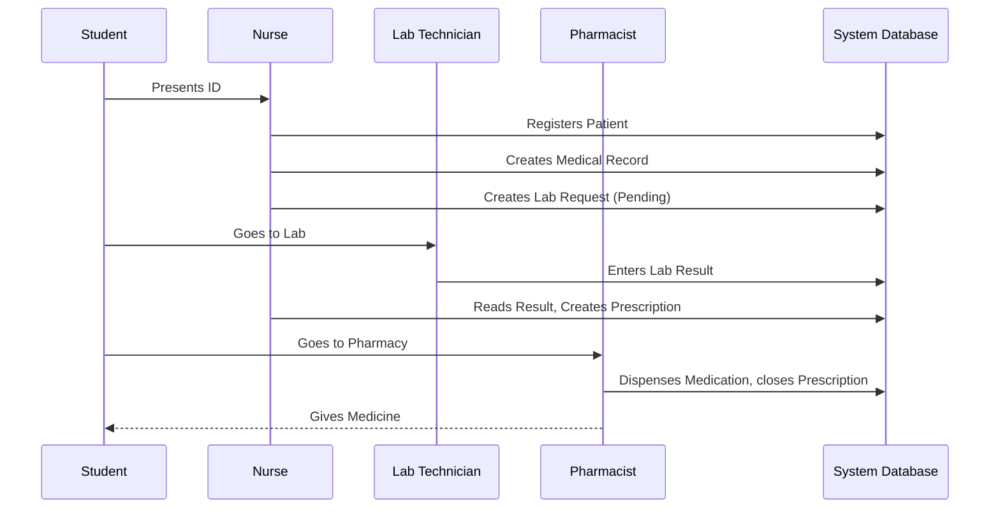
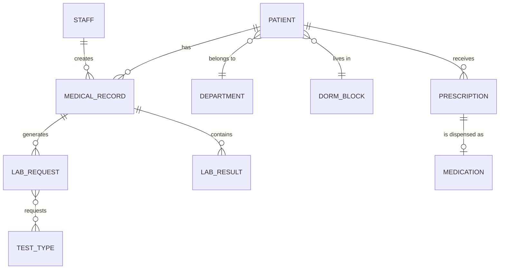

# HU IoT Student Clinic Management System Documentation

## Executive Summary
This document provides a comprehensive technical and functional analysis of the **HU IoT Student Clinic Management System**, currently under development for Hawassa University. This report is based on a direct inspection of the existing C# ASP.NET Core MVC project source code, database models, controllers, and configuration files. It maps the implemented functionality against the real-world operational workflows of an Ethiopian university outpatient clinic, identifies technical gaps, and provides an actionable roadmap for future development.

---

## PART 1: PROJECT OVERVIEW

### 1. Purpose of the System
The system is designed to digitize and manage the day-to-day clinical operations of the student clinic at Hawassa University. It aims to replace paper-based health records and card room inefficiencies with an integrated electronic medical record (EMR) system tailored specifically to university students.

### 2. Real-World Problem It Solves
University clinics in Ethiopia typically struggle with lost paper records (cards), long student waiting times, lack of communication between the consultation room and the laboratory/pharmacy, and difficulties in generating daily/monthly Ministry of Health (MoH) reports. This system provides a unified database to track a student’s health journey from registration to medicine dispensing.

### 3. Intended Users
- **Health Officer (Admin):** Manages the clinic, oversees staff, reviews reports, and provides clinical consultation.
- **Nurse:** Registers students, performs triage/initial assessment, handles general clinical duties, and can write prescriptions.
- **Laboratory Technician:** Receives lab requests, performs tests, and inputs results into the system.
- **Pharmacist:** Reviews prescriptions and records dispensed medications.
- **Student:** A planned role for patients to potentially view their queue status or records.

### 4. Actual Technologies Used
* **Framework:** ASP.NET Core MVC (.NET 10.0)
* **ORM:** Entity Framework Core (10.0.10)
* **Database:** Microsoft SQL Server (LocalDB/Express during development)
* **Authentication:** ASP.NET Core Identity
* **Frontend:** Razor Pages/Views (HTML/CSS/JS) with Bootstrap.
* **Reporting:** HTML Views intended to be printed as PDFs.

### 5. Application Architecture
The project follows a standard **N-Tier Monolithic MVC Architecture**:
* **Presentation Layer:** Razor `.cshtml` files organized by domain (e.g., `Views/Patients`, `Views/MedicalRecords`).
* **Controller Layer:** Handlers (e.g., `PatientsController`) that process HTTP requests, enforce Role-Based Access Control (RBAC) via `[Authorize]` attributes, and map ViewModels to Domain Models.
* **Data Access Layer:** `ApplicationDbContext` handles database interactions using EF Core.

### 6. Component Connectivity
When a user accesses the system, `Program.cs` bootstraps the application and configures dependency injection (e.g., `ApplicationDbContext`, `INotificationService`, Identity). Requests hit the Controller, which queries the SQL Server database via EF Core, binds the result to a ViewModel, and passes it to the Razor View to render the HTML returned to the browser.

### 7. Main Implemented Features
- User Authentication & Role Management.
- Student/Patient Registration (linked to Hawassa University Departments and Dorm Blocks).
- Medical Record creation.
- Laboratory Workflow (Requests, Test Types, and Results).
- Pharmacy Workflow (Prescribing and Dispensing logs).
- Basic Queue management and Notifications.

### 8. Limitations of Current Implementation
- **Inventory Management:** The `Medication` model currently acts as a dispensing log rather than a true subtractive pharmacy inventory system.
- **PDF Generation:** The "DetailedReportPdf" currently renders an HTML view, relying on the user's browser to "Print to PDF", rather than a server-side PDF generator (like iText or Rotativa).
- **Real-Time Updates:** Notifications and Queues appear to rely on page reloads rather than real-time WebSocket (SignalR) pushes.

---

## PART 2: HOW A SMALL ETHIOPIAN CLINIC OPERATES

According to the *Ethiopian Minimum Regulatory Standards for Health Facilities* (issued by the EFDA / Ministry of Health), a primary clinic operates through the following workflow:

1. **Patient Arrival & Registration (Card Room):** Patients arrive, present identification (Student ID), and are registered. A medical card is retrieved or created.
2. **Triage & Vital Signs:** A nurse takes vital signs (Blood Pressure, Weight, Temp) to prioritize emergency cases.
3. **Queueing:** Patients wait outside the consultation room.
4. **Clinical Consultation:** A Health Officer or General Practitioner evaluates the patient, documents the Chief Complaint, performs a physical exam, and forms a provisional diagnosis.
5. **Laboratory Requests:** If needed, the clinician writes a lab request.
6. **Specimen Collection & Testing:** The patient visits the lab. The technician collects the specimen (blood, stool, urine), performs the test, and records the result.
7. **Result Review & Prescription:** The patient returns to the clinician with the result. A final diagnosis is made, and a prescription is written on a standard MoH prescription pad.
8. **Medicine Dispensing:** The patient goes to the pharmacy. The pharmacist verifies the prescription, dispenses the available medicine, and updates stock cards (Bin cards).
9. **Referral/Follow-up:** If the clinic cannot treat the patient, a formal referral paper is written to a higher-level facility (e.g., Hawassa University Comprehensive Specialized Hospital).

---

## PART 3: MAP REAL CLINIC WORKFLOW TO THE SYSTEM

| Real Clinic Workflow | Responsible Staff | Project Module / Page | Controller / Action | Database Entity | Status |
| :--- | :--- | :--- | :--- | :--- | :--- |
| **Registration** | Nurse / Receptionist | `Patients/Create` | `PatientsController.Create` | `Patient` | Implemented. Includes HU-specific fields (`DormBlockID`, `DepartmentID`). |
| **Triage / Vitals** | Nurse | N/A (Integrated into Medical Record) | `MedicalRecordsController.Create` | `MedicalRecord` (Notes) | **Missing specific fields.** Vitals must be typed manually into `GeneralAppearance` or `Notes`. |
| **Queueing** | System | `Queue/Index` | `QueueController` | `Queue`, `ServicePoint` | Implemented but basic. Lacks real-time UI updates. |
| **Consultation** | Health Officer / Nurse | `MedicalRecords/Create` | `MedicalRecordsController.Create` | `MedicalRecord` | Implemented. Captures `ChiefComplaint`, `Diagnosis`, `Treatment`. |
| **Lab Request** | Health Officer / Nurse | `LabRequests/Create` | `LabRequestsController.Create` | `LabRequest`, `TestType` | Implemented. Links to multiple `TestTypes` via join table. |
| **Lab Testing** | Lab Technician | `LabResults/Create` | `LabResultsController.Create` | `LabResult` | Implemented. Lab tech can enter results mapped to a specific request. |
| **Prescribing** | Health Officer / Nurse | `Prescriptions/Create` | `PrescriptionsController.Create` | `Prescription` | Implemented. Stores `RX` text. |
| **Dispensing** | Pharmacist | `Prescriptions/Dispense` | `PrescriptionsController.Dispense` | `Medication` | Implemented. Records what was dispensed, but **lacks central inventory depletion**. |
| **Referrals** | Health Officer | *Not found in project* | *N/A* | *N/A* | **Not implemented.** |

---

## PART 4: COMPLETE PATIENT JOURNEY

### Scenario: A Patient Requiring Lab Tests and Medication

1. **Registration:** The student arrives. The Nurse logs in, navigates to "Add Patient", and enters the student's ID, Name, Dorm Block, and Department. The system saves a `Patient` record.
2. **Consultation:** The Nurse/Health Officer creates a `MedicalRecord` for the patient, noting "Fever and headache" in the `ChiefComplaint` field.
3. **Lab Request:** Unsure of the diagnosis, the clinician clicks "Request Lab", selects the patient and medical record, and checks "Blood Film" and "WBC" from the `TestType` list. A `LabRequest` is created with Status = "Pending".
4. **Lab Testing:** The Lab Technician logs in, sees the Pending request, collects the blood, and creates a `LabResult`. The `LabResult` is saved, and the request status updates.
5. **Prescription:** The clinician reviews the result, determines it is Malaria, and creates a `Prescription` (e.g., "Coartem"). Status is "Pending".
6. **Dispensing:** The Pharmacist logs in, sees the Pending prescription, hands the student the drugs, and clicks "Dispense". The system prompts for the exact `MedicationName` and `Amount` given, saving it to the `Medication` table and changing the Prescription status to "Dispensed".

---

## PART 5: STAFF ROLES AND PERMISSIONS

Authentication is handled via ASP.NET Core Identity with Cookie Authentication. Authorization is strictly enforced on the server side using the `[Authorize(Roles = "...")]` attribute on controllers.

| Role | Responsibilities | Accessible Controllers (Verified in Code) |
| :--- | :--- | :--- |
| **HealthOfficer** | Full clinic administration, consultation, reporting. | `Reports`, `UserManagement`, `Patients`, `MedicalRecords`, `LabRequests`, `Prescriptions`, `Settings` |
| **Nurse** | Registration, triage, minor consultations. | `Nurse`, `Patients`, `MedicalRecords`, `LabRequests`, `Prescriptions` |
| **LabTechnician** | Managing lab requests and results. | `LabTechnician`, `LabRequests` (Edit only), `LabResults` |
| **Pharmacist** | Dispensing medicine. | `Pharmacist`, `Prescriptions` (Dispense only), `Medications` |
| **Student** | Patient portal (Placeholder). | Redirected to `/Student/Dashboard` upon login. |

**Strengths:** Server-side authorization is properly implemented. Users cannot access restricted pages via direct URL manipulation because the `[Authorize]` attribute will return a 403 Forbidden or redirect to login.
**Weaknesses:** Any Nurse can edit any Medical Record. There is no row-level security ensuring a clinician can only edit records they created.

---

## PART 6: DATABASE DESIGN

The database is built using Entity Framework Core Code-First Migrations.

### Key Entities
* **Patient:** Central entity. Links to `Department` and `DormBlock` (Many-to-One).
* **MedicalRecord:** Links to `Patient` (One-to-Many). Contains clinical notes.
* **LabRequest:** Links to `Patient`, `MedicalRecord`, and `Staff` (RequestedBy). Uses a Many-to-Many join table (`LabRequestTestTypes`) to connect to `TestType` (e.g., Stool, Blood Film).
* **LabResult:** Links to `MedicalRecord` and `TestType`. 
* **Prescription:** Links to `Patient` and `Staff` (PrescribedBy).
* **Medication:** Links to `Prescription` and `Staff` (Pharmacist). Represents the actual drug handed to the patient.

**Database Design Observations:**
* **Multiple Cascade Paths:** A known SQL Server issue existed where deleting a Patient attempted to cascade delete Lab Requests directly AND via Medical Records simultaneously. *(Note: Code inspection shows this was recently mitigated using `DeleteBehavior.Restrict` in `ApplicationDbContext.cs`)*.
* The system excellently supports multiple visits for the same patient, as `MedicalRecord` is a One-to-Many relationship with `Patient`.

---

## PART 7: MODULE-BY-MODULE ANALYSIS

1. **Authentication:** Implemented securely via ASP.NET Identity.
2. **User Management:** Implemented (`UserManagementController`). Health Officers can create staff accounts.
3. **Patient Registration & Search:** Implemented (`PatientsController`). Works well.
4. **Triage / Vitals:** **Incomplete.** No dedicated Vitals table (BP, HR, Temp).
5. **Medical Records:** Implemented (`MedicalRecordsController`).
6. **Lab Workflow:** Implemented (`LabRequestsController`, `LabResultsController`). The many-to-many relationship with `TestType` allows multiple tests per request.
7. **Pharmacy / Inventory:** **Partially Implemented.** Prescribing and dispensing work (`PrescriptionsController.Dispense`), but there is no central `PharmacyInventory` table to track stock levels and batch expirations, which is a MoH requirement.
8. **Notifications:** Implemented (`NotificationsController` & `NotificationService`). Saves to DB, but requires page refresh to see new bell icons.
9. **Reports:** Implemented (`ReportsController`). Generates UI summaries. PDF export relies on browser printing.
10. **Referrals:** **Absent.**

---

## PART 8: COMPLETE TECHNICAL WORKFLOW (Example: Lab Request)

1. **User Action:** Nurse clicks "Create Lab Request" on a patient's medical record.
2. **GET Request:** `LabRequestsController.Create(int medicalRecordId)` is hit. It verifies the Nurse role, loads available `TestTypes` from the DB, and returns a `LabRequestCreateViewModel` to the View.
3. **User Input:** Nurse selects tests via checkboxes and clicks Submit.
4. **POST Request:** Form data is sent back to `LabRequestsController.Create(LabRequestCreateViewModel vm)`.
5. **Validation:** ASP.NET validates the ViewModel.
6. **Data Binding & DB Interaction:** The controller maps the ViewModel to a new `LabRequest` entity. It queries the DB for the selected `TestType` IDs and adds them to the entity's navigation property.
7. **Persistence:** `_context.Add(labRequest)` and `await _context.SaveChangesAsync()` are called. EF Core translates this to `INSERT` SQL statements.
8. **Response:** The controller uses `_notificationService` to alert Lab Techs, then redirects the Nurse back to the Medical Record details page with a success message.

---

## PART 9: NOTIFICATIONS AND INTERDEPARTMENTAL COMMUNICATION

**Current Implementation:**
The `Notification` entity stores messages. `NotificationService` is injected into controllers. When a Nurse creates a Lab Request, the controller triggers a notification for all users in the "LabTechnician" role. A ViewComponent (`NotificationBell`) queries unread notifications for the logged-in user and displays a red badge in the layout header.

**Clinic Reality Check:**
In a real busy clinic, staff do not constantly refresh their web pages. Relying solely on page-refresh notifications may cause delays in urgent care. 
**Recommendation:** Implement SignalR for real-time WebSocket pushing of notifications.

---

## PART 10: SECURITY, PRIVACY, AND DATA INTEGRITY

* **Authentication:** Strong (Identity).
* **Role Authorization:** Strong (Server-side attributes).
* **Data Privacy Risk:** Any user with the "Nurse" or "HealthOfficer" role can view *any* student's medical record in the database. In a university clinic, privacy is critical (e.g., STI treatments, pregnancy tests). A mechanism to audit "Who viewed what record" (Audit Logging) is highly recommended.
* **SQL Injection / XSS:** Mitigated by using EF Core (parameterized queries) and Razor (auto-HTML encoding).
* **CSRF:** ASP.NET Core MVC forms automatically include Anti-Forgery Tokens.

---

## PART 11: GAP ANALYSIS AND RECOMMENDATIONS

### CRITICAL (Fix Immediately)
* **Pharmacy Inventory:** A clinic cannot operate legally without tracking medicine stock. You must create an `Inventory` model to track `MedicineName`, `BatchNumber`, `ExpiryDate`, and `Quantity`. The `Dispense` action must subtract from this quantity.

### HIGH (Important for Operations)
* **Vitals Model:** Create a `Vitals` or `Triage` model linked to `MedicalRecord` to store Temperature, Blood Pressure, Heart Rate, and Weight.
* **Audit Logs:** Log whenever a user views or edits a medical record to protect student privacy.

### MEDIUM (Usability)
* **Real-time Notifications:** Add SignalR so the Lab Technician hears a "ding" or sees a popup immediately when a lab request is submitted.
* **Referrals:** Add a `Referral` entity to document when a student is sent to Hawassa University Referral Hospital.

### LOW (Optional)
* **Server-side PDFs:** Integrate a library like `DinkToPdf` or `QuestPDF` in the `ReportsController` to generate actual, downloadable, non-editable PDF files for MoH reporting.

---

## PART 12: TESTING THE CURRENT SYSTEM

**Manual Testing Checklist:**
1. **Role Access Check:** Log in as `pharmacist@hu.edu.et`. Try to navigate to `/MedicalRecords/Create` directly in the URL bar.
   * *Expected:* Access Denied (Redirected or 403 Forbidden).
2. **Lab Workflow:** Log in as Nurse. Create a Lab Request. Log out. Log in as Lab Tech. Verify the request is visible and status is "Pending". Enter results. Verify status changes to "Completed".
3. **Duplicate Detection:** Attempt to register a patient with an existing `IDNumber`.
   * *Expected:* If not implemented, the system will create a duplicate. (Verify this behavior).
4. **Database Persistence:** Create a Prescription. Stop the web server. Start it again. Verify the Prescription is still there.

---

## PART 13: FINAL DOCUMENTATION SUMMARY

**A. Executive Summary:** The HU IoT Clinic system is a solidly architected, highly functional MVC application that successfully digitizes the core workflows of an Ethiopian university clinic.
**B. Tech Stack:** .NET 10, EF Core 10, SQL Server, Bootstrap.
**C. Implemented Modules:** Auth, Patient Registration, Medical Records, Lab Requests/Results, Prescribing/Dispensing, Reports (HTML).
**D. Incomplete Modules:** Pharmacy Inventory Tracking, Triage Vitals, Referrals, Real-time WebSockets.
**E. Security:** Robust RBAC, but lacks Row-Level Security and Audit Logging for patient data privacy.
**F. Questions for Hawassa University Staff:**
   1. *Do you need the system to stop a pharmacist from dispensing a medicine if the system says stock is zero?*
   2. *What exact Vitals do you record during triage?*
   3. *Do you need to track specific ICD-11 codes for Diagnoses, or is free text acceptable?*

This system forms an excellent, working foundation. By adding true pharmacy inventory management and real-time notifications, it will be fully ready for deployment in a live clinical environment.
